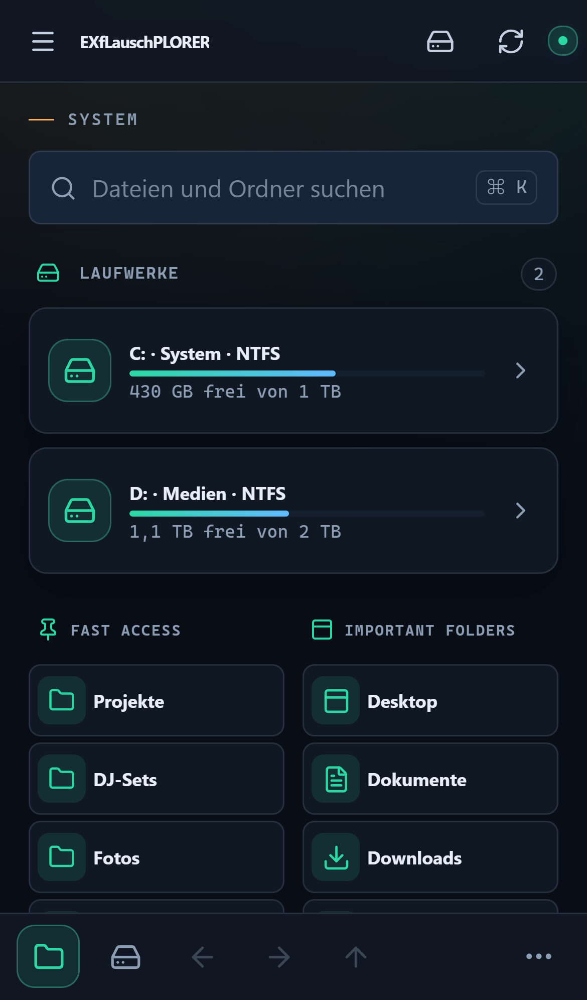

# EXfLauschPLORER

Your Windows PC, in your pocket. No cloud, no open ports, no extra passwords.

Your files already live on your PC. EXfLauschPLORER lets you reach them from your phone, wherever you are, without syncing or uploading them anywhere first.

It's not a sync folder and not a remote desktop. It's a file explorer for the PC itself, rebuilt for a touch screen. Open a PDF on the train, stream a three-hour DJ set, grab a file for an email, or upload photos straight into the right folder. It runs in your phone's browser or from the home screen like a regular app; the files stay on your PC.

The app and installer UI are currently German; menu labels in this README are translated for readability.

| System at a glance | Files on the go | Music from your PC |
|:---:|:---:|:---:|
|  |  |  |

The screenshots show the original UI with entirely fictional demo drives, folders, and titles. The waveform is a demo data set too.

## Feels like Explorer, and then some

If you use Windows Explorer, you already know your way around. Quick Access, the address bar, back/forward/up, the recycle bin, properties, undo, and the familiar "Replace, Skip, or Keep both" dialog all work the way you'd expect, and the functions sit roughly where you'd look for them.

It also does a few things Explorer can't:

- Folder sizes in the file list. Switch to the folder-size sort to calculate sizes for the folders in the current view; large or still-running scans can show an incomplete value.
- File checksums in the properties dialog, no extra tools needed.
- Waveform seeking for audio, so you can jump straight to the drop in a long mix.
- Clean mode that lists caches and leftover temp files and only deletes what you pick.

## What it doesn't need

- No cloud. Files stay on your PC. Nothing goes to a third-party service, and there's no storage quota.
- No open ports. The app server listens only on 127.0.0.1. It's reachable solely through your private Tailscale network, encrypted end to end with WireGuard.
- No extra accounts. Your Tailscale identity is your login. Only accounts you allow get in, with an optional PIN on top.
- No admin rights, no server to babysit. A regular Windows install; the setup wizard configures Tailscale Serve for you.

## About Tailscale

Tailscale connects your devices into a private network, as if your phone were sitting at home next to your PC, wherever you actually are. It's free for personal use (the Personal plan covers unlimited devices and up to six users), and you sign in with an existing Google, Microsoft, Apple or GitHub account.

You set it up once and then forget about it. On the iPhone it quietly stays connected in the background, so when you open EXfLauschPLORER, your PC is simply there. No VPN to switch on, no router settings, no IP addresses to remember.

You'll need: a Windows PC that's switched on and signed in, and Tailscale on both the PC and your phone (iPhone or Android).

## What you can do

- Browse your PC: Open drives, Windows Quick Access, important folders, and favorites directly on your phone; search, sort, and switch between views.
- Manage files: Copy, move, rename, upload and download, and use the recycle bin and properties. The actions actually available depend on Windows permissions and your shares.
- Read PDFs: Open multi-page documents directly in the app, switch pages, and zoom; password-protected PDFs can be displayed after entering the password.
- Stream music and video: Media stays on the PC. The player offers a queue, a floating mini view, a timeline, and seeks. For audio files, a waveform can help with seeking.
- Find space hogs: Clean mode lists supported cache and temporary files for selection with details. Nothing is deleted until you explicitly select it and confirm in the app.
- Stay available: Autostart and a watchdog for unexpected crashes can be enabled separately during setup.

## Quick start

### 1. Set up the Windows PC

1. Download the current Windows installer from the Releases and run it as a normal Windows user. A ZIP package is also available there: extract it completely and open ZIP-starten.cmd.
2. The setup dialog checks whether Tailscale is installed and connected. If needed, the links lead to the Windows installation and the Tailscale help. Sign in and check again.
3. Choose shares, autostart, and the crash watchdog. New installations share the user folder by default. Existing shares are preserved if the selection is unchanged. Make further changes on the Windows PC via "Open configuration" in the notification area.
4. Start setup. It configures the local service and Tailscale Serve and shows your personal HTTPS address. If Tailscale asks for consent to use Serve, follow the displayed link and run setup again. MagicDNS and HTTPS must be available in the tailnet.

The installer includes the required .NET runtime; Node.js and the .NET SDK are not needed for the finished packages. The app does not require administrator rights and installs for the current Windows user. Tailscale itself may require elevated rights for its installation.

### 2. Connect your iPhone or iPad

1. Install Tailscale for iOS, sign in to the same tailnet, and enable the connection. An Android app is also available. Leave Tailscale switched on: it runs in the background and reconnects by itself.
2. Open the HTTPS address shown by setup on the device in Safari. You can also copy the address from the app icon in the Windows notification area.
3. Optional: choose Share → Add to Home Screen. EXfLauschPLORER then opens like its own app.

The PC must be turned on and signed in, and both devices must be able to reach Tailscale. The UI runs on the mobile device; the files and server remain on the PC.

## Good to know

- Playback depends on the audio and video formats your device's browser supports. Conversion during playback is not built in.
- The audio waveform requires FFmpeg and FFprobe on the PC. Without them, the normal timeline remains usable. See the technical manual.
- The PDF preview uses Mozilla PDF.js and displays one page at a time. Fillable forms and text selection are not supported in this preview; open the file in a suitable PDF app to edit it.
- The watchdog restarts the app after an unexpected process exit and limits repeated restarts. A regular Quit from the tray menu remains a quit; with autostart active, the app starts again at the next Windows login. The watchdog does not detect an app that is hung but still running.
- Shares apply within the Windows rights of the logged-in user. Browser profiles, autostart, SSH keys, and the app's data folder are blocked from file access. You can view your shares in the web app.
- Uninstalling removes the program and autostart. Settings and an existing Tailscale Serve route remain; such a route can be removed separately in Tailscale if needed.
- The source code and releases are publicly available. Access to a running app goes through your own Tailscale network.

## Build from source

Requirements: Windows x64, Node.js 22.13 or newer and npm, the .NET 10 SDK, and Tailscale. In the project folder:

```powershell
.\setup.ps1
```

The script builds the frontend and the Windows host if needed. Creating the installer and ZIP additionally requires Inno Setup; see the build guide. Development details, security, API, and tests are in the technical manual.

## Project status

The detailed status matrix, including limitations and open hardware/iOS checks, is in FEATURES.md. "Done" means implemented and covered by the corresponding automated test; hardware, iOS, and media benchmarks are marked separately as not verified. Version history is in CHANGELOG.md.

## How it works

```text
iPhone / Android browser or home-screen app
                  │
            Tailscale HTTPS
                  │
        Windows PC: Tailscale Serve
                  │
        local EXfLauschPLORER server
                  │
       shared Windows files
```

The server runs in the logged-in Windows session. Tailscale Serve brokers the connection; the app checks the Tailscale identity and its shares. The server listens on 127.0.0.1, not directly on the local network.

## Contributing

Bug reports and feature ideas are welcome. Read CONTRIBUTING.md and use the bug-report form. For security issues, see SECURITY.md — do not open a public issue.

## License

EXfLauschPLORER is licensed under the MIT License. Dependencies retain their own licenses.
