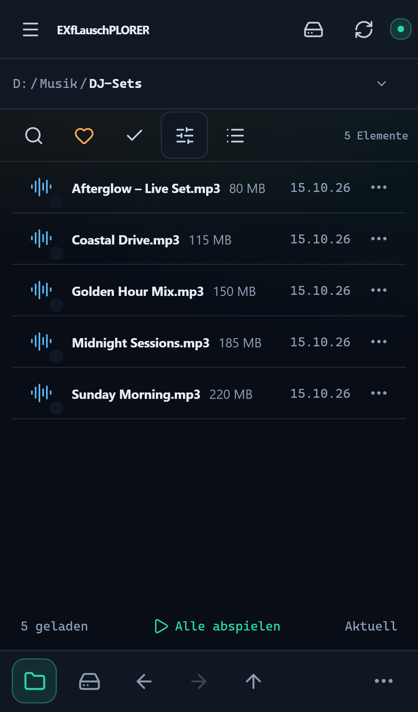
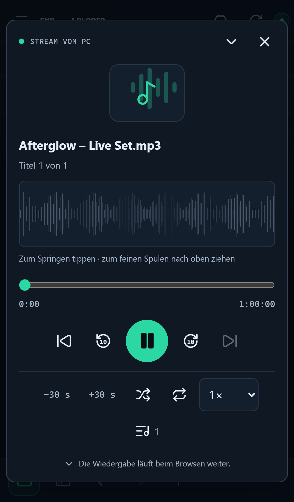

# EXfLauschPLORER

**Dein Windows-PC. Deine Dateien. Auf dem Handy – auch unterwegs.**

EXfLauschPLORER verbindet einen Windows-PC über dein privates Tailscale-Netz mit deinem Smartphone. Öffne Laufwerke und Ordner, verwalte Dateien und streame Musik oder Videos direkt vom PC. Auf dem Handy läuft die Oberfläche als Web-App im Browser oder wie eine App vom Home-Bildschirm; der Windows-PC stellt die Dateien bereit.

| System im Blick | Dateien unterwegs | Musik direkt vom PC |
|:---:|:---:|:---:|
|  |  |  |

*Die Bilder zeigen die Originaloberfläche mit vollständig erfundenen Demo-Laufwerken, Ordnern und Titeln. Die Wellenform ist ebenfalls ein Demo-Datensatz.*

## Was du damit machen kannst

- **Deinen PC durchsuchen:** Laufwerke, Windows-Schnellzugriffe, wichtige Ordner und Favoriten direkt auf dem Handy öffnen; suchen, sortieren und zwischen Ansichten wechseln.
- **Dateien verwalten:** Kopieren, verschieben, umbenennen, hoch- und herunterladen sowie Papierkorb und Eigenschaften nutzen. Die tatsächlich verfügbaren Aktionen hängen von den Windows-Rechten und deinen Freigaben ab.
- **PDFs lesen:** Mehrseitige Dokumente direkt in der App öffnen, zwischen Seiten wechseln und vergrößern; passwortgeschützte PDFs lassen sich nach Eingabe des Passworts anzeigen.
- **Musik und Videos streamen:** Medien bleiben auf dem PC. Der Player bietet Warteschlange, schwebende Miniansicht, Zeitleiste und Sprünge. Für Audiodateien kann eine Wellenform beim Spulen helfen.
- **Platzfresser finden:** Der Clean-Modus zeigt unterstützte Cache- und temporäre Dateien zur Auswahl mit Informationen an. Gelöscht wird erst nach ausdrücklicher Auswahl und Bestätigung in der App.
- **Privat verbinden:** Tailscale Serve stellt den Zugriff innerhalb des Tailnets bereit; der lokale App-Server lauscht nur auf dem PC. Eine Anmeldeliste und optionaler PIN ergänzen den Zugriffsschutz.
- **Dranbleiben:** Autostart und ein Wächter für unerwartete Abstürze lassen sich bei der Einrichtung getrennt aktivieren.

## Schnellstart

### 1. Windows-PC einrichten

1. Lade den aktuellen **Windows-Installer** aus den [Releases](https://github.com/00fLausch/exflauschplorer/releases/latest) herunter und starte ihn als normaler Windows-Benutzer. Alternativ gibt es dort ein ZIP-Paket: vollständig entpacken und `ZIP-starten.cmd` öffnen.
2. Der Einrichtungsdialog prüft, ob Tailscale installiert und verbunden ist. Falls nötig, führen die Links zur [Windows-Installation](https://tailscale.com/download/windows) und zur [Tailscale-Hilfe](https://tailscale.com/docs/install). Melde dich an und prüfe erneut.
3. Wähle Freigaben, Autostart und Absturzwächter. Neue Installationen teilen standardmäßig den Benutzerordner. Vorhandene Freigaben bleiben bei unveränderter Auswahl erhalten. Weitere Änderungen nimmst du am Windows-PC über „Konfiguration öffnen“ im Infobereich vor.
4. Starte die Einrichtung. Sie richtet den lokalen Dienst und Tailscale Serve ein und zeigt die persönliche HTTPS-Adresse an. Wenn Tailscale eine Freigabe für Serve verlangt, folge dem angezeigten Hinweis und starte die Einrichtung erneut. MagicDNS und HTTPS müssen im Tailnet verfügbar sein.

Der Installer enthält die benötigte .NET-Laufzeit; Node.js und das .NET-SDK sind für die fertigen Pakete nicht nötig. Die App benötigt keine Administratorrechte und installiert sich für den aktuellen Windows-Benutzer. Tailscale selbst kann für seine Installation erhöhte Rechte benötigen.

### 2. iPhone oder iPad verbinden

1. Installiere [Tailscale für iOS](https://tailscale.com/download/ios), melde dich im selben Tailnet an und aktiviere die Verbindung. Für Android gibt es ebenfalls eine [Tailscale-App](https://tailscale.com/download/android).
2. Öffne die vom Setup angezeigte HTTPS-Adresse auf dem Gerät in Safari. Die Adresse lässt sich auch über das App-Symbol im Windows-Infobereich kopieren.
3. Optional: **Teilen → Zum Home-Bildschirm** auswählen. So öffnet sich EXfLauschPLORER wie eine eigene App.

Der PC muss eingeschaltet und angemeldet sein, und beide Geräte müssen Tailscale erreichen. Die Bedienoberfläche läuft auf dem Mobilgerät; die Dateien und der Server bleiben auf dem PC.

## Gut zu wissen

- Die Wiedergabe hängt von den Audio- und Videoformaten ab, die der Browser auf deinem Gerät unterstützt. Eine Umwandlung während der Wiedergabe ist nicht eingebaut.
- Für die Audio-Wellenform werden **FFmpeg und FFprobe auf dem PC** benötigt. Ohne sie bleibt die normale Zeitleiste bedienbar. Mehr dazu im [technischen Handbuch](docs/manual.md).
- Die PDF-Vorschau verwendet [Mozilla PDF.js](https://mozilla.github.io/pdf.js/) und stellt jeweils eine Seite dar. Ausfüllbare Formulare und Textauswahl werden in dieser Vorschau nicht unterstützt; zum Bearbeiten die Datei in einer passenden PDF-App öffnen.
- Der Wächter startet die App nach einem unerwarteten Prozessabbruch erneut und begrenzt wiederholte Neustarts. Ein reguläres **Beenden** über das Tray-Menü bleibt ein Beenden; bei aktivem Autostart startet die App bei der nächsten Windows-Anmeldung erneut. Eine hängende, aber weiterhin laufende App erkennt der Wächter nicht.
- Freigaben gelten innerhalb der Windows-Rechte des angemeldeten Benutzers. Browserprofile, Autostart, SSH-Schlüssel und der Datenordner der App sind für den Dateizugriff gesperrt. In der Web-App kannst du deine Freigaben ansehen.
- Beim Deinstallieren werden Programm und Autostart entfernt. Einstellungen und eine bestehende Tailscale-Serve-Route bleiben erhalten; eine solche Route kann bei Bedarf in Tailscale separat entfernt werden.
- Der Quellcode und die Releases sind öffentlich verfügbar. Der Zugriff auf eine laufende App erfolgt über das eigene Tailscale-Netz.

## Aus dem Quellcode

Voraussetzungen: Windows x64, Node.js 22.13 oder neuer und npm, .NET-10-SDK und Tailscale. Im Projektordner:

```powershell
.\setup.ps1
```

Das Skript baut bei Bedarf das Frontend und den Windows-Host. Für das Erstellen von Installer und ZIP wird zusätzlich Inno Setup benötigt; siehe [Build-Anleitung](installer/BUILD.md). Entwicklungsdetails, Sicherheit, API und Tests stehen im [technischen Handbuch](docs/manual.md).

## So funktioniert es

```text
iPhone / Android Browser oder Home-Bildschirm-App
                  │
            Tailscale HTTPS
                  │
        Windows-PC: Tailscale Serve
                  │
        lokaler EXfLauschPLORER-Server
                  │
       freigegebene Windows-Dateien
```

Der Server wird in der angemeldeten Windows-Sitzung ausgeführt. Tailscale Serve vermittelt die Verbindung; die App prüft die Tailscale-Identität und ihre Freigaben. Der Server lauscht auf `127.0.0.1`, nicht direkt im lokalen Netzwerk.
